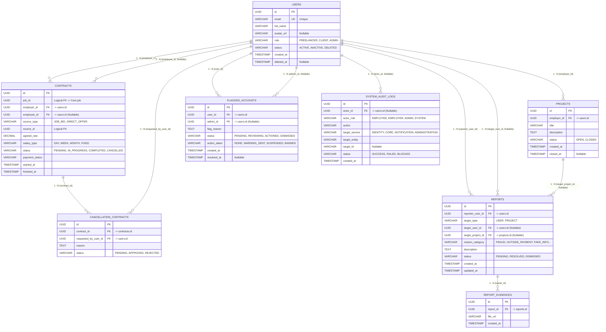

# Occupify Administration Service - Database ERD Specification

> **Bounded Context**: **Administration & Audit** (`occupify-administration`)  
> **Database Name**: `occupify_administration` (PostgreSQL 16)  
> **Port**: `8185`  
> **Reference Architecture**: Microservices Architecture with Local Replicated Entities

---

## 1. Overview

The **Administration Service** is responsible for platform governance, violation reporting, evidence management, account moderation, and cross-service immutable audit logging.

It contains **8 tables** divided into two architectural groups:
1. **Domain Native Tables (Blue)**:
   - `reports`: User or project violation reports submitted by community members.
   - `report_evidences`: Uploaded evidence files (screenshots, chat logs, documents) supporting reports.
   - `flagged_accounts`: Suspect accounts flagged for administrative review and enforcement actions.
   - `system_audit_logs`: Immutable, append-only operational audit log tracking critical platform actions.
2. **Local Replicated Tables (Red)**:
   - `users`: Synchronized from `occupify-identity` via Domain Events (`UserActivatedEvent`).
   - `projects`: Synchronized from `occupify-core` (`ProjectCreatedEvent`, `ProjectClosedEvent`).
   - `contracts`: Synchronized from `occupify-core` (`ContractAcceptedEvent`, `ContractRejectedEvent`).
   - `cancellation_contracts`: Synchronized from `occupify-core` / `occupify-payment`.

---

## 2. Entity Relationship Diagram (ERD)

---

## 3. Data Dictionary

### 3.1. `users` (Local Replicated Entity from Identity)
| Column | Type | Constraints | Description |
|:---|:---|:---|:---|
| `id` | UUID | PRIMARY KEY | User identifier synced from Identity |
| `email` | VARCHAR(255) | UNIQUE, NOT NULL | User email address |
| `full_name` | VARCHAR(150) | NOT NULL | User display name |
| `avatar_url` | VARCHAR(500) | NULLABLE | Profile picture URL |
| `role` | VARCHAR(50) | NOT NULL | `FREELANCER`, `CLIENT`, `ADMIN` |
| `status` | VARCHAR(50) | NOT NULL | `ACTIVE`, `INACTIVE`, `DELETED` |
| `created_at` | TIMESTAMP | NOT NULL | Creation timestamp |
| `deleted_at` | TIMESTAMP | NULLABLE | Soft deletion timestamp |

### 3.2. `projects` (Local Replicated Entity from Core)
| Column | Type | Constraints | Description |
|:---|:---|:---|:---|
| `id` | UUID | PRIMARY KEY | Project UUID synced from Core |
| `employer_id` | UUID | FK -> `users(id)`, NOT NULL | Project owner |
| `title` | VARCHAR(255) | NOT NULL | Project title |
| `description` | TEXT | NULLABLE | Project description |
| `status` | VARCHAR(50) | NOT NULL | `OPEN`, `CLOSED` |
| `created_at` | TIMESTAMP | NOT NULL | Project post timestamp |
| `closed_at` | TIMESTAMP | NULLABLE | Project closed timestamp |

### 3.3. `contracts` (Local Replicated Entity from Core)
| Column | Type | Constraints | Description |
|:---|:---|:---|:---|
| `id` | UUID | PRIMARY KEY | Contract UUID synced from Core |
| `job_id` | UUID | NOT NULL | Cross-service logical reference to Core job |
| `employer_id` | UUID | FK -> `users(id)`, NOT NULL | Employer party |
| `employee_id` | UUID | FK -> `users(id)`, NULLABLE | Freelancer party |
| `source_type` | VARCHAR(50) | NULLABLE | `JOB_BID`, `DIRECT_OFFER` |
| `source_id` | UUID | NULLABLE | Source bid/offer UUID |
| `agreed_rate` | DECIMAL(15, 2)| NULLABLE | Agreed rate/budget |
| `salary_type` | VARCHAR(50) | NULLABLE | `DAY`, `WEEK`, `MONTH`, `FIXED` |
| `status` | VARCHAR(50) | NOT NULL | `PENDING`, `IN_PROGRESS`, `COMPLETED`, `CANCELLED` |
| `payment_status`| VARCHAR(50)| NULLABLE | Payment state |
| `started_at` | TIMESTAMP | NULLABLE | Engagement start timestamp |
| `finished_at` | TIMESTAMP | NULLABLE | Engagement completion timestamp |

### 3.4. `cancellation_contracts`
| Column | Type | Constraints | Description |
|:---|:---|:---|:---|
| `id` | UUID | PRIMARY KEY | Cancellation record UUID |
| `contract_id` | UUID | FK -> `contracts(id)`, NOT NULL | Target contract |
| `requested_by_user_id` | UUID | FK -> `users(id)`, NOT NULL | Party requesting cancellation |
| `reason` | TEXT | NULLABLE | Cancellation reasoning |
| `status` | VARCHAR(50) | NOT NULL | `PENDING`, `APPROVED`, `REJECTED` |

### 3.5. `reports` (Native Domain Entity)
| Column | Type | Constraints | Description |
|:---|:---|:---|:---|
| `id` | UUID | PRIMARY KEY | Report UUID |
| `reporter_user_id` | UUID | FK -> `users(id)`, NOT NULL | User filing report |
| `target_type` | VARCHAR(50) | NOT NULL | Target type: `USER`, `PROJECT` |
| `target_user_id` | UUID | FK -> `users(id)`, NULLABLE | Reported user UUID (if target is USER) |
| `target_project_id`| UUID | FK -> `projects(id)`, NULLABLE| Reported project UUID (if target is PROJECT)|
| `reason_category` | VARCHAR(50) | NOT NULL | `FRAUD`, `OUTSIDE_PAYMENT`, `FAKE_INFORMATION`, `SPAM_HARASSMENT`, `OTHER` |
| `description` | TEXT | NULLABLE | Report narrative |
| `status` | VARCHAR(50) | NOT NULL DEFAULT `'PENDING'` | `PENDING`, `RESOLVED`, `DISMISSED` |
| `created_at` | TIMESTAMP | NOT NULL DEFAULT CURRENT_TIMESTAMP | Submission timestamp |
| `updated_at` | TIMESTAMP | NOT NULL DEFAULT CURRENT_TIMESTAMP | Last review timestamp |

### 3.6. `report_evidences` (Native Domain Entity)
| Column | Type | Constraints | Description |
|:---|:---|:---|:---|
| `id` | UUID | PRIMARY KEY | Evidence file UUID |
| `report_id` | UUID | FK -> `reports(id)` ON DELETE CASCADE | Parent report |
| `file_url` | VARCHAR(500) | NOT NULL | S3 / Cloud storage link to evidence |
| `created_at` | TIMESTAMP | NOT NULL DEFAULT CURRENT_TIMESTAMP | Upload timestamp |

### 3.7. `flagged_accounts` (Native Domain Entity)
| Column | Type | Constraints | Description |
|:---|:---|:---|:---|
| `id` | UUID | PRIMARY KEY | Flag record UUID |
| `user_id` | UUID | FK -> `users(id)`, NOT NULL | Flagged account |
| `admin_id` | UUID | FK -> `users(id)`, NULLABLE | Admin who flagged or resolved |
| `flag_reason` | TEXT | NOT NULL | Violation or risk explanation |
| `status` | VARCHAR(50) | NOT NULL DEFAULT `'PENDING'` | `PENDING`, `REVIEWING`, `ACTIONED`, `DISMISSED` |
| `action_taken` | VARCHAR(50) | NOT NULL DEFAULT `'NONE'` | `NONE`, `WARNING_SENT`, `SUSPENDED`, `BANNED` |
| `created_at` | TIMESTAMP | NOT NULL DEFAULT CURRENT_TIMESTAMP | Flag creation timestamp |
| `resolved_at` | TIMESTAMP | NULLABLE | Resolution timestamp |

### 3.8. `system_audit_logs` (Native Domain Entity)
| Column | Type | Constraints | Description |
|:---|:---|:---|:---|
| `id` | UUID | PRIMARY KEY | Audit log entry UUID |
| `actor_id` | UUID | FK -> `users(id)`, NULLABLE | User who performed action (null for SYSTEM) |
| `actor_role` | VARCHAR(50) | NOT NULL | `EMPLOYEE`, `EMPLOYER`, `ADMIN`, `SYSTEM` |
| `action` | VARCHAR(100) | NOT NULL | Action key (e.g. `CONTRACT_ACCEPTED`, `USER_SUSPENDED`)|
| `target_service` | VARCHAR(50) | NOT NULL | `IDENTITY`, `CORE`, `NOTIFICATION`, `ADMINISTRATION` |
| `target_entity` | VARCHAR(100) | NOT NULL | Entity name (`CONTRACT`, `USER`, `PROJECT`) |
| `target_id` | VARCHAR(100) | NULLABLE | Target entity UUID string |
| `status` | VARCHAR(50) | NOT NULL | `SUCCESS`, `FAILED`, `BLOCKED` |
| `created_at` | TIMESTAMP | NOT NULL DEFAULT CURRENT_TIMESTAMP | Audit occurrence timestamp |
